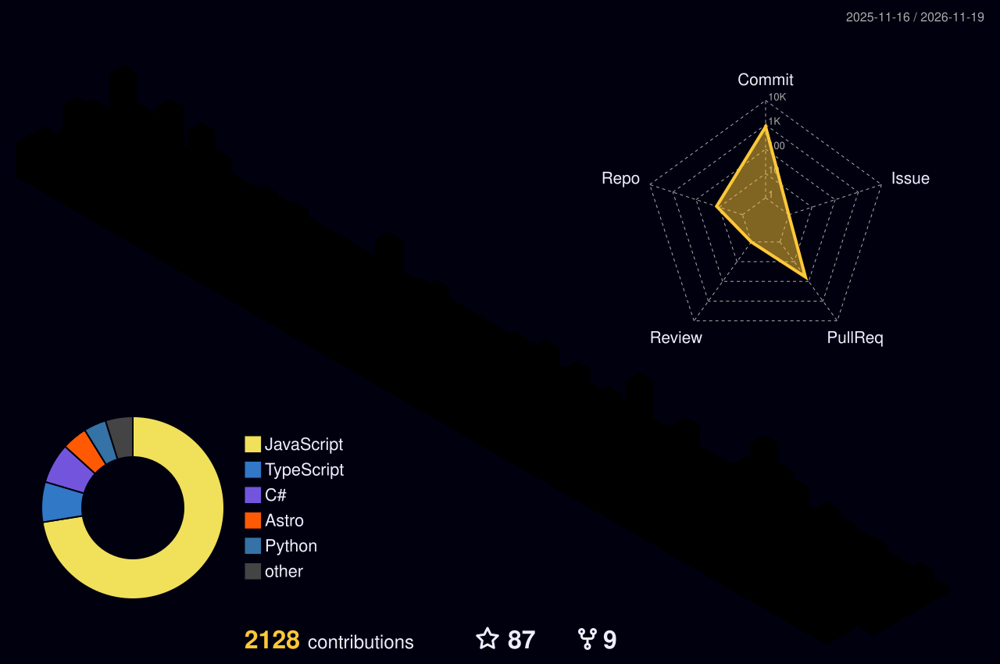

# LoveDoLove

**Software Engineer | AI Coding Agents · Developer Tooling · Cloud Infrastructure**

I build engineering intelligence for AI coding agents, developer tooling that eliminates friction between intent and execution, and cloud infrastructure that scales reliably. Focused on persistent agent memory, structural codebase intelligence, and distributed serverless architectures.

[Portfolio](https://portfolio.lovedolove.qzz.io) • [GitHub](https://github.com/LoveDoLove) • [LinkedIn](https://www.linkedin.com/in/chong-jun-xiang) • [Email](mailto:v0130p5100cuboss@gmail.com)

---

## About Me

I build software systems that make AI-assisted engineering trustworthy and edge infrastructure resilient. My work focuses on addressing long-horizon context loss in coding agents, providing deterministic code-graph navigation, and building maintainable edge services on modern cloud platforms.

Core engineering principles:
- **Subtract before adding:** Minimize layers, eliminate speculative abstractions, and keep state scopes small.
- **Evidence-backed automation:** Validate before asserting, flag stale assumptions against live code, and make systems self-verifying.
- **Resilient edge architectures:** Design for low-latency serverless execution, graceful degradation, and idempotent operations.

---

## Engineering Focus

| Domain | Focus & Systems |
|---|---|
| **AI Coding Agents** | Dual-Brain architectures, persistent engineering memory, validation states (`unverified → reviewed → verified`), authority progressions, and live AST staleness detection. |
| **Developer Tooling** | Model Context Protocol (MCP) bridges, CLI plugins, knowledge-graph code search, symbol tracing, and developer friction reduction. |
| **Cloud Infrastructure** | Cloudflare Workers, edge caching with granular purging, dynamic HTTP load balancing, DNS automation, and serverless-first architectures. |
| **Systems & Automation** | Cross-platform build engineering (Linux, FreeBSD, Windows), CI/CD workflows, automated incident recovery tooling, and reproducible environments. |

---

## Featured Engineering Projects

### [Veyra](https://github.com/LoveDoLove/Veyra) `Primary Flagship`

**Engineering intelligence for AI coding agents.** A DeepSeek Harness plugin implementing a Dual-Brain architecture to mitigate agent context loss and repository disorientation across sessions:

- **Persistent Engineering Memory:** Captures evidence-backed lessons with explicit validation stages (`unverified → reviewed → verified`) and authority tiers (`candidate → derived → canonical`), retrieved via SQLite FTS5 hybrid search.
- **AST Code Intelligence:** Derives live structural code facts via `codebase-memory-mcp` and proactively flags stale memories when anchored source files change.
- **Zero-Dependency Runtime:** Self-contained local execution (~130 kB packed) with no external runtime npm dependencies, daemons, or API keys.

**Tech:** `TypeScript` · `Node.js` · `SQLite / FTS5` · `MCP` · `Cordis Plugin Framework`

---

### [dsh-codebase-memory-mcp](https://github.com/LoveDoLove/dsh-codebase-memory-mcp) `Core Infrastructure`

**Codebase Memory MCP bridge for DeepSeek Harness.** Integrates structural code intelligence directly into agent tool surfaces:

- **Native Tool Exposure:** Registers six knowledge-graph tools for symbol discovery, snippet extraction, and call-path tracing over stdio JSON-RPC 2.0.
- **Guided Exploration:** Injects runtime guidance steering agents toward AST-level structural analysis over unstructured text searches.
- **Resilient Lifecycle:** Manages daemon process lifecycles and Web UI startup with graceful degradation across plugin hooks.

**Tech:** `TypeScript` · `MCP` · `Cordis` · `stdio JSON-RPC` · `Process Management`

---

### [cloudflare-load-balancer](https://github.com/LoveDoLove/cloudflare-load-balancer)

**Cloudflare Worker-based HTTP load balancer.** Provides low-latency traffic routing and fault tolerance at the edge:

- **Traffic Distribution:** Routes requests across multiple origin servers using configurable weight policies.
- **Health Probing & Failover:** Monitors origin availability with automated failover to standby endpoints.
- **Operational Controls:** Supports edge maintenance-mode routing without origin reconfiguration.

**Tech:** `JavaScript` · `Cloudflare Workers` · `Wrangler` · `Edge Networking`

---

### [cloudflare-smart-cache](https://github.com/LoveDoLove/cloudflare-smart-cache)

**Cloudflare edge caching and invalidation plugin for WordPress.** Delivers low-latency page caching with targeted purging:

- **Automated Invalidation:** Purges specific edge cache entries upon content modification to prevent stale delivery.
- **Admin Dashboard:** Provides an AJAX-driven interface for manual cache controls, token authentication, and purge logging.
- **Modular Policies:** Implements structured invalidation rules to prevent cache stampedes under heavy traffic.

**Tech:** `PHP` · `TypeScript` · `JavaScript` · `Cloudflare API` · `WordPress`

---

### [cf-best-domain](https://github.com/LoveDoLove/cf-best-domain)

**Cloudflare DNS A-record optimizer and latency benchmarking tool.** Automates Anycast endpoint selection:

- **Latency Benchmarking:** Probes Cloudflare Anycast IP ranges to identify lowest-latency, minimal-packet-loss routes.
- **DNS Record Automation:** Updates Cloudflare DNS records programmatically via GitHub Actions or Workers Cron triggers.

**Tech:** `Python` · `Cloudflare API` · `GitHub Actions` · `DNS Automation`

---

### [alist-freebsd](https://github.com/LoveDoLove/alist-freebsd)

**FreeBSD build automation and CI pipeline for the Alist file management service.**

- **Targeted Toolchain Build:** Custom `build.sh` pipeline compiling upstream Go sources natively for FreeBSD environments.
- **Automated CI Workflows:** GitHub Actions integration producing release artifacts for non-Linux targets.

**Tech:** `Shell` · `GitHub Actions` · `FreeBSD Toolchain` · `CI/CD`

---

## Technical Expertise

- **Languages:** TypeScript, JavaScript, Python, PHP, Shell (Bash/Zsh/sh), C#, SQL
- **AI & Agent Engineering:** Model Context Protocol (MCP), DeepSeek Harness, Cordis Architecture, Retrieval-Augmented Generation (RAG), Hybrid Search (FTS5 + Vector + Graph), Agent Tool Surface Design
- **Cloud & Edge Platforms:** Cloudflare Workers, Cloudflare DNS / CDN / WAF, AWS (Cloud Architect, Web App Builder, Cloud Foundations), Edge Compute, Serverless Architecture
- **Systems & DevOps:** GitHub Actions CI/CD, Linux Kernel Diagnostics, FreeBSD Toolchains, Windows Tooling, Git Workflow Automation, System Call Profiling
- **Databases & Frameworks:** SQLite (FTS5), Node.js, Astro, Next.js, Vite, Tailwind CSS

---

## Experience & Education

### Experience

**Cloud & Network Engineer Intern** — Sangfor Technologies *(2023–2024)*
- Triaged L1/L2 global infrastructure incidents across Hyper-Converged Infrastructure (HCI), Enterprise Cloud Platform, and VDI systems, maintaining 95%+ SLA adherence.
- Led storage split-brain diagnostics and recovery operations under live production conditions.
- Conducted Linux kernel diagnostics, system call tracing, and network packet analysis to isolate platform bottlenecks.
- Designed and implemented automated repository migration tooling from Git to AWS CodeCommit.

### Education & Credentials

- **B.I.T. (Hons.) Software Systems Development** — Tunku Abdul Rahman University of Management and Technology (TAR UMT)
- **AWS Academy Graduate** — AWS Academy Cloud Architect, Cloud Web Application Builder, Cloud Foundations (2024–2025)
- **AWS Educate** — Cloud Computing 101
- **Cisco Networking Academy** — Enterprise Networking & Security Coursework (CCNA curriculum)

---

## GitHub Activity

  <picture>
    <source media="(prefers-color-scheme: dark)" srcset="profile-snake/github-snake-dark.svg" />
    <source media="(prefers-color-scheme: light)" srcset="profile-snake/github-snake.svg" />
    
  </picture>

  

  

  
  

---

## Connect

  
  
  
  

---

  Engineering intelligence for coding agents · Developer tooling that reduces friction · Cloud infrastructure that scales

